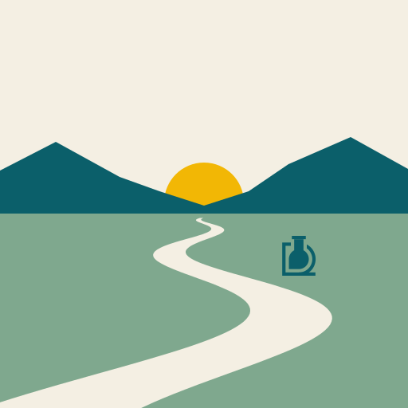
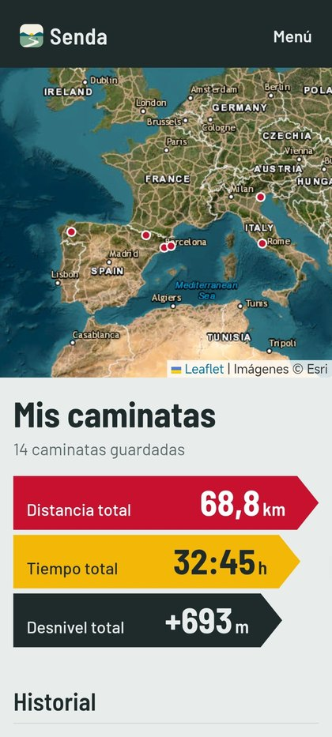
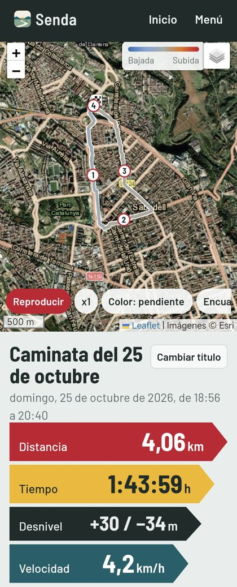
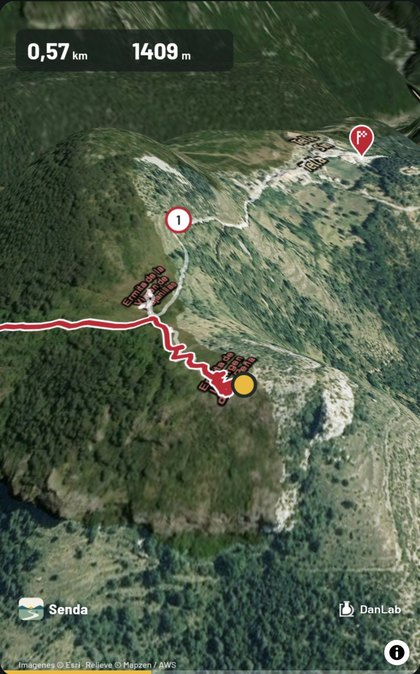
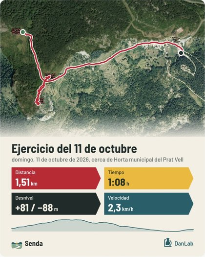

  

<h1 align="center">Senda</h1>

  <b>Tus caminatas y viajes por etapas, sobre el mapa.</b> 
  Una app para Android de <b>DanLab</b>.

  
  
  

---

Senda guarda cada ruta que haces con tu reloj y te la enseña con su mapa, su perfil, tus fotos y los pueblos por los que pasaste. Agrupa caminatas en viajes por etapas, como el Camino de Santiago, y convierte cualquier ruta en un vídeo en 3D para compartir.

  
  
  
  

## Qué puedes hacer

**🗺️ Cada ruta en su mapa**
Satélite con calles y pueblos, topográfico o callejero. La ruta se colorea por pendiente, altitud, velocidad o pulso, con las marcas de cada kilómetro.

**📊 Todos tus datos**
Distancia, tiempo, desnivel de subida y bajada, velocidad, ritmo, pulso, calorías y el perfil de altitud.

**⌚ Detecta tus caminatas sola**
Con Health Connect, Senda te avisa de cada caminata nueva de tu reloj (Zepp y otros) sin exportar nada. También abre archivos GPX, TCX y FIT.

**📷 Tus fotos en el camino**
Busca en tu galería las fotos que hiciste durante la caminata y las coloca en su punto de la ruta. Las de WhatsApp, sin hora, las colocas tú tocando el mapa.

**🥾 Viajes por etapas**
Agrupa caminatas en un viaje y míralo entero: el recorrido completo con cada etapa en su color, los totales y los pueblos del camino.

**🎬 Vuelo 3D y vídeo**
Un vuelo sobre el relieve siguiendo tus pasos, con chinchetas, kilómetros y tus fotos, que se graba como vídeo vertical para WhatsApp, Instagram o TikTok.

**📤 Compartir como imagen**
Una imagen con el mapa y tus datos, lista para enviar.

**☁️ Copia en Google Drive**
Copia automática de tus caminatas, viajes y fotos en tu propia cuenta de Google. Si cambias de móvil, la recuperas al instalar Senda.

**🔄 Siempre al día**
Senda te avisa cuando hay versión nueva y se actualiza con un toque.

## Cómo instalarla

1. Desde el móvil, entra en **[Releases](https://github.com/monster3dani/senda/releases/latest)** y descarga el archivo `Senda-x.x.x.apk`.
2. Ábrelo. Si Android lo pide, permite instalar apps de esta fuente.
3. Pulsa **Instalar**.

Las versiones nuevas se instalan encima, sin perder nada.

## Primeros pasos

- **Con Health Connect**: en Zepp, ve a *Perfil*, luego a *Servicios de terceros* y activa *Health Connect*. En Senda, pulsa *Configurar* y da permiso. A partir de ahí, Senda te avisará de cada caminata nueva.
- **Con archivos**: exporta la actividad desde la app de tu reloj, mejor en formato **FIT**, y ábrela desde el menú de Senda, en *Añadir caminata*.
- **Copia de seguridad**: en el menú, entra en *Google Drive* y pulsa *Conectar con Google*.

## Privacidad

Tus datos se guardan en tu móvil. Senda no tiene servidores propios, no muestra publicidad y no comparte nada con nadie. La copia de seguridad, si la activas, va a una carpeta privada de tu propio Google Drive.

Más detalles en la **[política de privacidad](PRIVACIDAD.md)**.

## Apoya Senda

Senda es gratis y la hago en mi tiempo libre. Si te gusta y quieres apoyar que siga mejorando, puedes **[invitarme a un café ☕](https://paypal.me/AndySans)**.

## Créditos

Mapas e imágenes de satélite de Esri, OpenStreetMap y OpenTopoMap. Relieve de Mapzen / AWS. Poblaciones de OpenStreetMap. Construida con Capacitor, Leaflet y MapLibre.

---

   
  Senda, una app de <b>DanLab</b>

